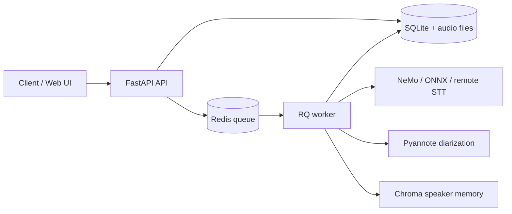

# NoobScribe

**NoobScribe** is a FastAPI service that exposes a **Whisper-shaped** HTTP API for speech-to-text. The default local engine is **[NVIDIA Canary 1B v2](https://huggingface.co/nvidia/canary-1b-v2)** via **[NVIDIA NeMo](https://github.com/NVIDIA/NeMo)**; **ONNX Canary** variants and a **remote OpenAI-compatible STT** (`USE_API=1`) are also supported. Optional **[Pyannote.audio](https://github.com/pyannote/pyannote-audio)** speaker diarization ([default pipeline on Hugging Face](https://huggingface.co/pyannote/speaker-diarization-community-1)) and **[Chroma](https://www.trychroma.com/)** speaker memory run alongside ASR.

It is **not** a drop-in OpenAI Whisper server: transcription is always **async** (`202` + job poll), local ASR is Canary (not Whisper weights), and several Whisper form fields are accepted but ignored. See [Whisper API compatibility](#whisper-api-compatibility).

Use case: run a zero-install transcription workflow from the browser — upload meeting audio or record live from mic/tab audio, then review and manage speaker-labeled transcripts in one place.

> **Attribution:** Based on **[parakeet-diarized](https://github.com/jfgonsalves/parakeet-diarized)** by [jfgonsalves](https://github.com/jfgonsalves). See **[ATTRIBUTION.md](ATTRIBUTION.md)** for file-level provenance and licensing notes.

**Author:** [meganoob1337](https://github.com/meganoob1337)

**Development note:** This project was developed using Cursor as an assistive tool, with direction from a human and additional manual edits by the author.

## Features

- Whisper-shaped `POST /v1/audio/transcriptions` (`json`, `text`, `srt`, `vtt`, `verbose_json`) — always **`202 Accepted`**; poll `GET /v1/transcription-jobs/{job_id}` for `result`. Queued via **Redis + RQ workers**. OpenAI-style uploads are **not** stored in the recordings library.
- Segment timestamps (`timestamps` or `verbose_json`); optional **speaker diarization** (`diarize`, default `true`)
- **Speaker embedding memory** ([**Chroma**](https://www.trychroma.com/)) with display names and re-matching across stored transcripts
- **Recording library** ([**SQLAlchemy**](https://www.sqlalchemy.org/) + SQLite + on-disk audio) and **Web UI** at `/ui` (transcript view: per-segment play/pause via `GET /v1/audio/snippet`, streams only on play)
- Optional **spoken language ID** ([**SpeechBrain**](https://speechbrain.github.io/) · [VoxLingua107 ECAPA](https://huggingface.co/speechbrain/lang-id-voxlingua107-ecapa)) when `language` is omitted — up to three 30s samples (start / middle / 75%), majority vote; shorter clips use one sample
- Offline options: `MODEL_PATH` (local NeMo `.nemo` or ONNX model directory when the registry entry allows it), `DIARIZATION_MODEL_PATH` (local [**Pyannote**](https://github.com/pyannote/pyannote-audio) pipeline)
- **Curated local ASR models** — `ASR_MODEL` selects a key from [`config/asr_models.yaml`](config/asr_models.yaml) (NeMo Canary, ONNX Canary int8/fp32 via [onnx-asr](https://istupakov.github.io/onnx-asr/)); unknown keys fail at startup. Remote STT uses `USE_API=1` + `MODEL_ID` instead.

Full endpoint reference: **[API_DOCUMENTATION.md](API_DOCUMENTATION.md)**

Web UI behavior inventory: **[frontend_features.md](frontend_features.md)**

## Whisper API compatibility

`POST /v1/audio/transcriptions` matches OpenAI’s path, multipart form, response formats, and `GET /v1/models`. Clients that can **poll jobs** and tolerate extra fields can use it; it is not a synchronous Whisper replica.

| Area | Behavior |
|------|----------|
| **Supported** | `file`; `language` (or SpeechBrain auto-ID when omitted); `response_format`; segment timestamps (`timestamps` / `verbose_json`); `GET /v1/models` |
| **Accepted, ignored** | `model` (server uses `ASR_MODEL` locally or env `MODEL_ID` when `USE_API=1`); `prompt`; `temperature`; `timestamp_granularities`; `vad_filter`; `word_timestamps` |
| **NoobScribe-only** | `diarize` (default `true`); `include_diarization_in_text`; `speakers[]` / segment `speaker`; job poll/cancel |
| **Not implemented** | `POST /v1/audio/translations`; word-level timestamps; a synchronous `200` transcript body |

There is no form-field model switch: pick the backend with `ASR_MODEL` / `USE_API` + `MODEL_ID`. Full contract: **[API_DOCUMENTATION.md](API_DOCUMENTATION.md)**.

## Core functionality

NoobScribe is built around a Whisper-shaped transcription API with persistent storage and speaker-aware post-processing:

- Accept audio uploads and transcribe them through the **configured backend** (NeMo Canary, ONNX Canary, or remote OpenAI-compatible STT) using a Whisper-style endpoint.
- Return transcript output in multiple formats (`json`, `text`, `srt`, `vtt`, `verbose_json`) with segment timestamps. Result is on the **job** after polling, not on the enqueue response.
- Optionally run **local** speaker diarization (pyannote) even when ASR is remote (`USE_API=1`), and attach speaker embeddings to transcript results.
- Match detected speakers against a stored speaker memory (Chroma) to reuse display names across recordings.
- Store recordings and transcription metadata in SQLite, with audio files persisted on disk. (`POST /v1/audio/transcriptions` itself does not create a library row.)
- Support language auto-detection (when `language` is omitted) and offline model paths for ASR/diarization.
- Queue transcription as **async jobs** (Redis + RQ): the API returns `202` with a job id; workers run ASR/diarization and persist results while the HTTP server stays responsive.

## Architecture

NoobScribe uses a **split API / worker** layout:



- **API** — HTTP, recordings library, speaker CRUD, job enqueue/cancel/poll. In Docker it sets **`SKIP_MODEL_LOAD=1`** and does not load NeMo in-process.
- **Redis + RQ** — `transcription` queue; all transcribe endpoints return **`202 Accepted`** immediately.
- **Worker** — `python -m workers.run` loads ASR/diarization models once, processes jobs, writes progress and results to SQLite.

Compose starts **`redis`**, **`noobscribe-api`**, and **`noobscribe-worker`** (or CPU/no-Traefik variants). Job lifecycle, health checks, and scaling notes are in **[DOCKER_README.md](DOCKER_README.md)**; the diagram above is the high-level layout.

## Implemented Web UI features

The built-in UI at `/ui` is a single-page app for managing recordings, transcripts, and speaker identities. Behavior inventory: **[frontend_features.md](frontend_features.md)**.

- **Recordings library:** paginated recordings list, responsive table/cards, and quick navigation to details.
- **Upload flow:** upload audio or video with optional recording name and immediate redirect to the created recording.
- **Browser recording:** capture microphone and/or tab/window audio, live level meters, preview, upload, and discard. In Chrome or Edge, enable **Share tab audio** or **Share system audio** in the share picker when capturing tab/screen audio. A floating picture-in-picture window shows recording time and mute/stop controls while you work in other apps.
- **Recording detail:** rename or **delete** recordings, play original audio, queue one or more transcription jobs (language, diarize, include speaker labels in text), chunk-level progress while a worker runs, and review prior transcription runs.
- **Jobs page (`#/jobs`):** list visible transcription jobs, live poll, cancel queued/running jobs, and open completed transcripts.
- **Transcript viewer:** formatted transcript, **copy**, `.txt` download, per-segment snippet playback, **re-match** against speaker memory, nearest-embedding similarity, and save detected speaker embeddings.
- **Speaker management:** list/delete speakers, add embeddings from snippet extraction or manual vector input, inspect embedding snippets, delete individual embeddings, and re-match stored transcripts.
- **Sidebar health:** model/queue status; amber warning when Redis is up but `workers_registered` is 0 (jobs stay queued).

## Quick start (Docker)

Prerequisites: [Docker](https://docs.docker.com/get-docker/). [NVIDIA Container Toolkit](https://docs.nvidia.com/datacenter/cloud-native/container-toolkit/install-guide.html) is required for **GPU** profiles; skip it for CPU profiles (see the matrix below).

**Pre-built image:** CI publishes **`ghcr.io/meganoob1337/noobscribe`**: GPU builds use tag **`latest`** (`linux/amd64` only). The **CPU** image ([Dockerfile.cpu](Dockerfile.cpu)) is published as **`latest-cpu`**, also **`linux/amd64` only**. **Tags are `latest` / `latest-cpu` on `main` and full semver** (e.g. `1.2.3`, `1.2.3-cpu`) on git tags `v*`. Compose uses the GHCR image by default so you can start without a local build. **On ARM machines (Apple Silicon, aarch64 Linux):** use CPU mode (see **[DOCKER_README.md](DOCKER_README.md)**), which sets **`platform: linux/amd64`** so Docker pulls the published amd64 image and runs it under emulation.

Copy **[env.example](env.example)** to `.env` and adjust values (Compose loads `.env` automatically; never commit secrets). The example sets **`COMPOSE_PROFILES=traefik`**, so `docker compose up -d` is **GPU + Traefik** (no host port). That needs `NOOBSCRIBE_HOST`, `TRAEFIK_NETWORK`, and an external Traefik network — not `localhost:8000`.

**Localhost without Traefik** (publishes `NOOBSCRIBE_PUBLISH_PORT`, default `8000:8000`):

```bash
cp env.example .env
docker compose --profile no-traefik up -d
```

CPU without Traefik: `docker compose --profile cpu-no-traefik up -d`. Traefik GPU default: set host/network in `.env`, then `docker compose up -d`.

To **build from source** instead (or after changing the app or Dockerfile):

```bash
docker compose build
docker compose --profile no-traefik up -d
```

Set **`NOOBSCRIBE_IMAGE`** in `.env` if you use a fork or a pinned digest/tag (see **[DOCKER_README.md](DOCKER_README.md)**).

With a **no-Traefik** profile:

- API: `http://localhost:8000`
- OpenAPI: `http://localhost:8000/docs`
- Web UI: `http://localhost:8000/ui` (or open `http://localhost:8000/` — redirects to `/ui`)

With Traefik, use `https://<NOOBSCRIBE_HOST>` instead.

Data persists under `./data` (mounted in Compose). Hugging Face cache can live under `./huggingface`.

Compose starts **three** services per profile: **`redis`**, **`noobscribe-api`** (HTTP only, no ASR model loaded), and **`noobscribe-worker`** (consumes transcription jobs). The API stays responsive while long transcriptions run in the worker container.

See **[DOCKER_README.md](DOCKER_README.md)** for environment variables, **Traefik + TLS**, and manual `docker run` examples.

### Compose profile matrix

| Mode | Command | Traefik | GPU | Host port publish | Worker service |
|------|---------|---------|-----|-------------------|----------------|
| Default | `docker compose up -d` | Yes | Yes | No | `noobscribe-worker` |
| CPU + Traefik | `docker compose --profile cpu up -d` | Yes | No | No | `noobscribe-worker-cpu` |
| GPU + no Traefik | `docker compose --profile no-traefik up -d` | No | Yes | Yes (`NOOBSCRIBE_PUBLISH_PORT`) | `noobscribe-worker-no-traefik` |
| CPU + no Traefik | `docker compose --profile cpu-no-traefik up -d` | No | No | Yes (`NOOBSCRIBE_PUBLISH_PORT`) | `noobscribe-worker-cpu-no-traefik` |

**Traefik (default):** `docker compose up -d` uses the default `traefik` profile from `.env` (`COMPOSE_PROFILES=traefik`), which runs GPU + Traefik with no host port publish. Set `NOOBSCRIBE_HOST` and `TRAEFIK_NETWORK` in `.env` (see `env.example`). Full steps in **DOCKER_README.md**.

### CPU-only (no GPU, no CUDA base image)

- **Compose (CPU + Traefik):** `docker compose --profile cpu up -d` — uses the single **[docker-compose.yml](docker-compose.yml)** in CPU mode (default image **`ghcr.io/.../noobscribe:latest-cpu`**, **`platform: linux/amd64`**, **`FORCE_CPU=1`**, no GPU reservations).
- **Compose (GPU + no Traefik):** `docker compose --profile no-traefik up -d` — publishes `NOOBSCRIBE_PUBLISH_PORT` (default `8000:8000`) and skips Traefik labels/network.
- **Compose (CPU + no Traefik):** `docker compose --profile cpu-no-traefik up -d` — CPU mode plus direct host port publish.
- Build image from **[Dockerfile.cpu](Dockerfile.cpu)** (uses [requirements.lock.txt](requirements.lock.txt) with CUDA-only pins stripped and CPU [PyTorch](https://pytorch.org/) wheels). The Dockerfile sets **`FORCE_CPU=1`** so inference stays on CPU.
- Example: `docker build -f Dockerfile.cpu -t noobscribe:cpu .`
- To force CPU on any deployment (including GPU images), set **`FORCE_CPU=1`** (or `true`/`yes`) in the environment. See **`GET /health`** for `force_cpu` and `cuda_available` in **[API_DOCUMENTATION.md](API_DOCUMENTATION.md)**.

## Local development (without Docker)

Requires **ffmpeg** on `PATH` (`run.sh` checks for it).

```bash
python -m venv venv
source venv/bin/activate   # Windows: venv\Scripts\activate
pip install -r requirements.txt
```

Set `HUGGINGFACE_ACCESS_TOKEN` if you use Hugging Face for diarization (or set `DIARIZATION_MODEL_PATH` for offline pyannote). **Pyannote-audio** models on Hugging Face are **gated**: sign in, open each model card you need (for example the default [speaker-diarization-community-1](https://huggingface.co/pyannote/speaker-diarization-community-1) pipeline), and **accept the access terms** on the card before downloads will succeed with your token.

Transcription requires **Redis** and a **worker** in addition to the API. Point **`REDIS_URL`** at the host Redis (Compose’s default `redis://redis:6379/0` is the Docker service name):

```bash
export REDIS_URL=redis://localhost:6379/0
redis-server   # or: docker run -p 6379:6379 redis:7-alpine

# Terminal 2 — worker (loads ASR model)
source venv/bin/activate
python -m workers.run

# Terminal 3 — API (skips model load)
SKIP_MODEL_LOAD=1 ./run.sh --hf-token "your_token"    # optional
# or
SKIP_MODEL_LOAD=1 ./run.sh --port 8000
```

## Configuration (high level)

| Variable | Default | Notes |
|----------|---------|--------|
| `USE_API` | _(unset)_ | Set to `1` / `true` / `yes` to transcribe via a **remote OpenAI-compatible Whisper API** instead of local ASR. Requires **`STT_BASE_URL`** and **`STT_API_KEY`**. **Diarization still runs locally** (pyannote / `DIARIZATION_MODEL_PATH`); you still need `HUGGINGFACE_ACCESS_TOKEN` or an offline diarization path when diarization is enabled. |
| `STT_BASE_URL` | _(unset)_ | Base URL for the remote STT service (e.g. `https://api.openai.com/v1`). Required when `USE_API` is set. |
| `STT_API_KEY` | _(unset)_ | API key for the remote STT service. Required when `USE_API` is set. |
| `ASR_MODEL` | `canary-1b-v2` | **Local mode:** registry key from [`config/asr_models.yaml`](config/asr_models.yaml) (`canary-1b-v2`, `canary-1b-v2-onnx-int8`, `canary-1b-v2-onnx`, …). Unknown keys error at startup. **Ignored when `USE_API` is set.** |
| `MODEL_ID` | `whisper-1` | **Remote API mode only** (`USE_API=1`): freeform model name sent to the remote STT API. Ignored in local mode (use `ASR_MODEL`). |
| `MODEL_PATH` | _(unset)_ | Optional offline path when the selected `ASR_MODEL` entry has `allow_path_override: true` (NeMo `.nemo` or ONNX model directory) |
| `DIARIZATION_MODEL_PATH` | _(unset)_ | Local [Pyannote](https://github.com/pyannote/pyannote-audio) pipeline dir |
| `HUGGINGFACE_ACCESS_TOKEN` | _(unset)_ | For [pyannote/speaker-diarization-community-1](https://huggingface.co/pyannote/speaker-diarization-community-1) when not offline; Pyannote models are **gated** on Hugging Face — you must accept the terms on each model card (see note below). **Compose** maps `.env` `HUGGINGFACE_TOKEN` to this name inside the container. |
| `DATABASE_URL` | `sqlite+aiosqlite:///./data/noobscribe.db` | Recordings metadata |
| `CHROMADB_PATH` | `./data/speakers` | [Chroma](https://www.trychroma.com/) speaker embedding store |
| `RECORDINGS_PATH` | `./data/recordings` | Uploaded audio |
| `TEMP_DIR` | `/tmp/noobscribe` | Temp transcoding |
| `CHUNK_MIN_DURATION` | `15` | Earliest pause cut after a chunk starts (seconds) |
| `CHUNK_MAX_DURATION` | `30` | Latest cut / force-split length (seconds) |
| `CHUNK_SILENCE_DB` | `-40` | ffmpeg `silencedetect` noise threshold (dB) |
| `CHUNK_SILENCE_MIN_DURATION` | `0.3` | Minimum pause length to treat as a cut point (seconds) |
| `SPEAKER_SIMILARITY_THRESHOLD` | `0.7` | Cosine similarity for speaker match |
| `SPEAKER_MATCH_MODE` | `nearest` | Identity matching: `nearest` (best enrollment cosine, default) or `centroid` (cosine vs the mean of a speaker’s enrollments). After changing, restart API **and** worker, then **Re-match transcripts**. |
| `DISABLE_LANGUAGE_ID` | _(unset)_ | When `1`/`true`/`yes`, skip SpeechBrain auto-detect when `language` is omitted |
| `FORCE_CPU` | _(unset)_ | When `1`/`true`/`yes`, use CPU for ASR, diarization, and language ID even if CUDA is available; **Dockerfile.cpu** sets this by default |
| `REDIS_URL` | `redis://redis:6379/0` | Redis connection for the transcription job queue. Compose uses the `redis` hostname; local (non-Docker) workers typically need `redis://localhost:6379/0`. |
| `QUEUE_TRANSCRIPTION` | `1` | When `0`, enqueue endpoints return `503` |
| `SKIP_MODEL_LOAD` | unset (`1` in Docker API) | API skips ASR load; run `python -m workers.run` for transcription |
| `LOAD_MODELS_ON_DEMAND` | unset (`false`) | When `1`/`true`/`yes`, do not preload the local ASR model at process start. The pipeline loads ASR after language ID / diarization and unloads it when the job finishes (saves idle VRAM; slower first inference). Language ID and diarization already load/unload per use. |

**Local ASR models** are defined in [`config/asr_models.yaml`](config/asr_models.yaml). To add a model, add an entry there (backend, source, quantization). `GET /v1/models` lists configured keys in local mode.

**ONNX Canary** (`ASR_MODEL=canary-1b-v2-onnx-int8`) uses [onnx-asr](https://istupakov.github.io/onnx-asr/) with [istupakov/canary-1b-v2-onnx](https://huggingface.co/istupakov/canary-1b-v2-onnx). Install `onnx-asr[cpu,hub]` or `onnx-asr[gpu,hub]` (Docker images include the matching extra). ONNX Runtime providers (CPU vs CUDA) are chosen automatically from the environment.

**Migrating from `MODEL_ID=nvidia/canary-1b-v2`:** use `ASR_MODEL=canary-1b-v2` instead.

**Gated Pyannote models:** The **pyannote-audio** checkpoints used for diarization (including the default pipeline and any sub-models it pulls) are hosted on Hugging Face under **gated** repositories. Create a [Hugging Face access token](https://huggingface.co/settings/tokens), then visit each required model page while logged in and **accept the user conditions** (e.g. “Agree and access repository”). Until you do, `huggingface_hub` may return access errors even with a valid token.

**Upgrading from speaker-diarization-3.1:** NoobScribe now uses **community-1** (pyannote.audio 4.x). Accept the terms on the [community-1 model card](https://huggingface.co/pyannote/speaker-diarization-community-1) separately from 3.1. For offline use, clone community-1 into `DIARIZATION_MODEL_PATH` (`git clone https://hf.co/pyannote/speaker-diarization-community-1 /path/to/dir`) — a cached 3.1 directory is not compatible. Existing speaker enrollments use the same WeSpeaker embedding family and should keep working; re-enrolling from a fresh clip may improve match quality.

## Testing

```bash
./venv/bin/python -m pip install -r requirements.txt pytest
./venv/bin/python -m pytest tests/ -q
./venv/bin/python tests/test_api.py --file /path/to/audio.wav --url http://localhost:8000
```

`tests/test_api.py` expects **`202` + job polling** (it does not treat the enqueue response as the transcript).

Diarization scoring against CALLHOME (DER) lives in [`tests/callhome_tests/README.md`](tests/callhome_tests/README.md).

### End-to-end performance evaluation

Use [`tests/evaluate_transcription_performance.py`](tests/evaluate_transcription_performance.py) to benchmark
transcription + diarization runtime and worker VRAM peak usage.

1. Edit `RECORDING_IDS` at the top of the script with existing recording UUIDs.
2. Ensure your API and worker containers are running.
3. Run:

```bash
./venv/bin/python tests/evaluate_transcription_performance.py
```

By default the script targets `NOOBSCRIBE_HOST` from your environment:
- if `NOOBSCRIBE_HOST` includes a scheme, it is used as-is (`http://...` / `https://...`);
- otherwise it uses `https://<NOOBSCRIBE_HOST>`;
- if unset, it falls back to `http://localhost:8000`.

Optional flags:
- `--url <base_url>` to override automatic `NOOBSCRIBE_HOST` resolution.
- `--worker-container <name>` to force a specific worker container.
- `--vram-sample-interval <seconds>` to tune VRAM sampling cadence.
- `--recording-ids <uuid1> <uuid2> ...` to override `RECORDING_IDS` without editing the script.

The script prints both a readable per-recording summary and a final JSON summary containing:
- input recording IDs,
- per-recording trigger, processing, end-to-end, model-load (`loading_diarization_model` / `loading_transcription_model`), diarization, and transcription durations,
- per-recording peak VRAM overall, during `diarization`, and during `transcribing`,
- aggregate totals and global peak VRAM.

Results are also written to `tests/performance_results/<timestamp>.json`.

## License

NoobScribe project code is licensed under the **MIT License**. See **[LICENSE](LICENSE)**.

For provenance details and upstream attribution, see **[ATTRIBUTION.md](ATTRIBUTION.md)**.

**ASR, language ID, and diarization models** have their own terms — see **[Canary](https://huggingface.co/nvidia/canary-1b-v2)**, **[Pyannote diarization](https://huggingface.co/pyannote/speaker-diarization-community-1)**, **[SpeechBrain VoxLingua107](https://huggingface.co/speechbrain/lang-id-voxlingua107-ecapa)**, and (for ONNX Canary) **[istupakov/canary-1b-v2-onnx](https://huggingface.co/istupakov/canary-1b-v2-onnx)** (Canary and community-1 are commonly **CC-BY-4.0**; confirm on each card you use).
